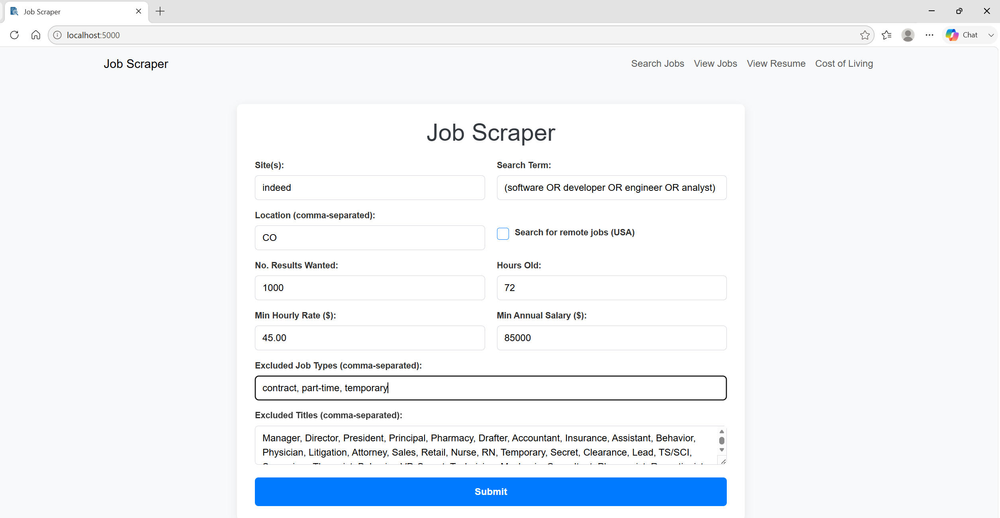
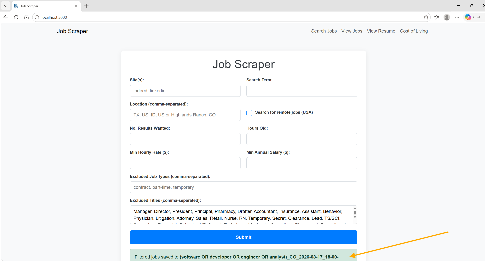
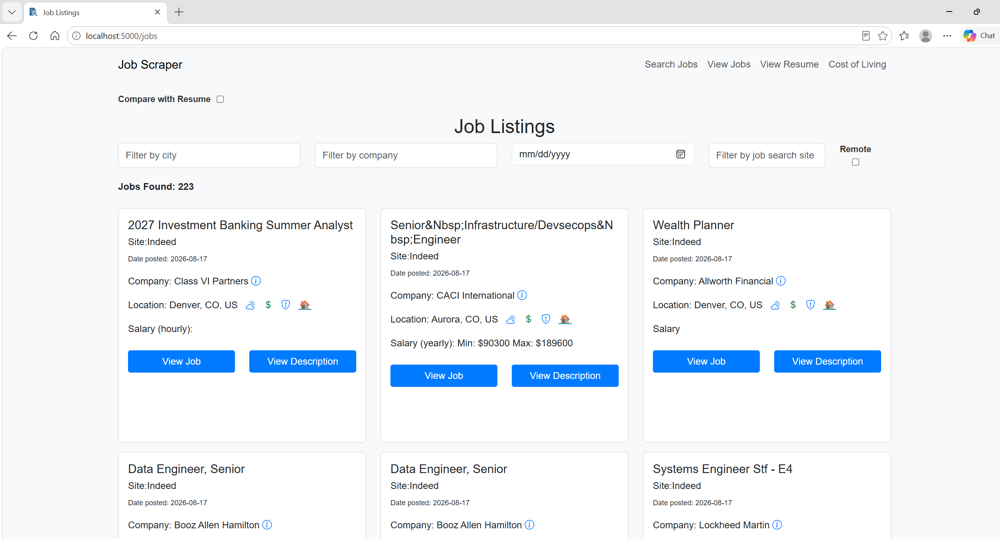
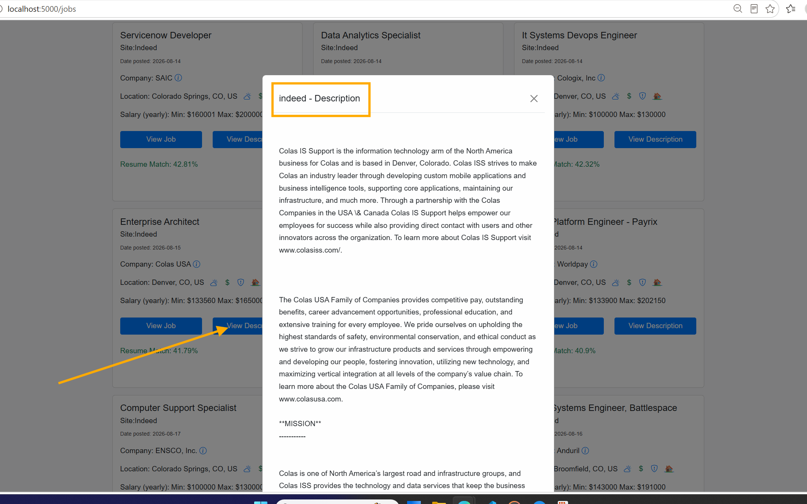
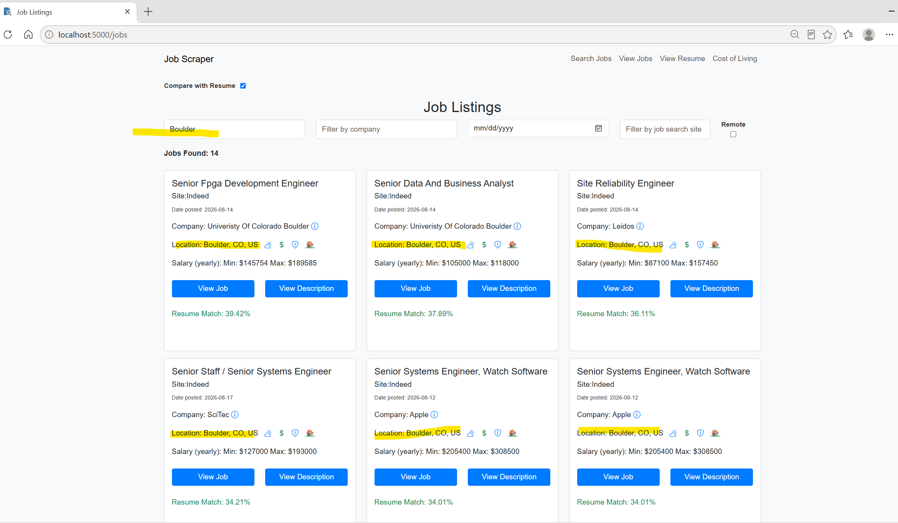
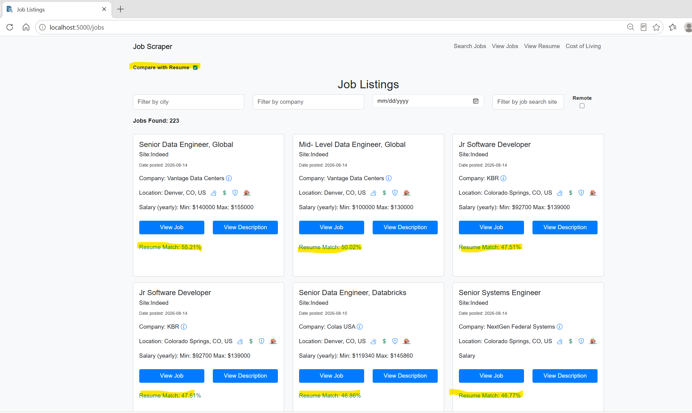
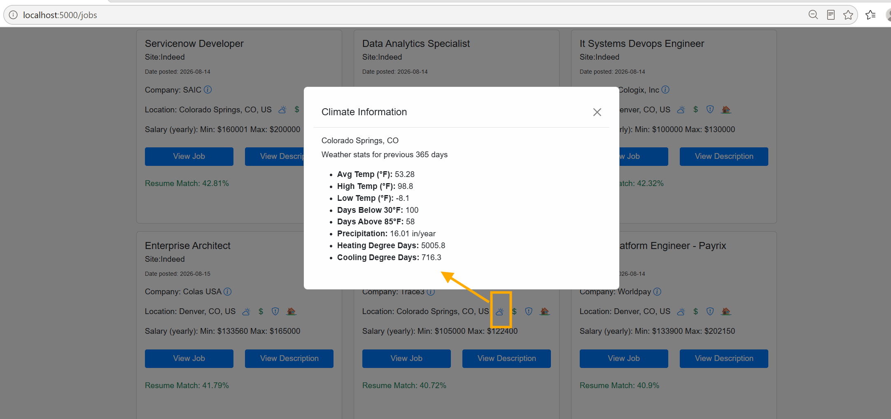
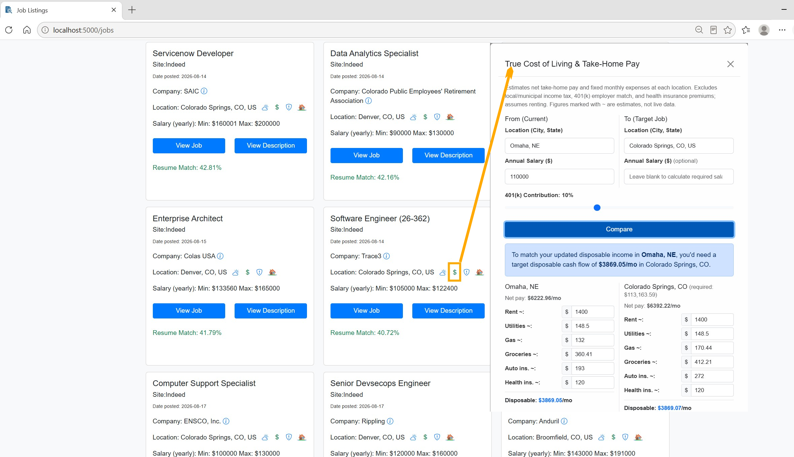

# Job Scraper

A Flask web app that fetches and filters job postings from multiple boards (Indeed, LinkedIn, Glassdoor) using [python-jobspy](https://github.com/speedyapply/JobSpy).

Note: No proxy is used, so results are best on Indeed and LinkedIn. Glassdoor is also accepted by the search form, but without a proxy it's more likely to be rate-limited or blocked. If a board fails, the app now logs the error and reports which sites had problems instead of failing the whole search.

## Prerequisites

- [Docker Desktop](https://www.docker.com/get-started/) installed and running.
- [uv](https://docs.astral.sh/uv/getting-started/installation/) (one time, to create the `uv.lock` file). No local install? See the Docker one-liner in step 3.
- (Optional, for Cost of Living features) API keys for the services listed in `.env.example`.

## Installation

1. Clone the repo and `cd` into it.
2. Copy the environment template and fill in your own values:

   ```bash
   cp .env.example .env
   ```

   - `SECRET_KEY` — signs session cookies. Generate one with
     `python -c "import secrets; print(secrets.token_hex(32))"`.
   - `APP_PASSWORD` (and optionally `APP_USERNAME`, default `admin`) — turns on a login prompt for the whole app, including your resume. Strongly recommended; see [Security](#security).

   The Cost of Living comparison feature uses these free/low-cost APIs — the app runs fine without them, but those calculations will be skipped:

   - [API Ninjas](https://api-ninjas.com/) — `API_NINJAS_KEY`
   - [OpenEI](https://openei.org/services/) — `OPENEI_API_KEY`
   - [EIA](https://www.eia.gov/opendata/register.php) — `EIA_API_KEY`
   - [HUD FMR API](https://www.huduser.gov/portal/dataset/fmr-api.html) — `HUD_FMR_API_TOKEN`
   - [BEA](https://apps.bea.gov/API/signup/) — `BEA_API_KEY`

   `.env` is gitignored and excluded from the Docker image — never commit it.

3. Create the dependency lockfile (the Docker build requires it; commit the result):

   ```bash
   uv lock
   # no uv installed? use Docker instead:
   docker run --rm -v "$PWD":/w -w /w ghcr.io/astral-sh/uv:0.11.7 lock
   ```

## Project Layout

```tree
.dockerignore
.env.example
ATTRIBUTION.md
docker-compose.yml          # default: hardened, no source mount
docker-compose.dev.yml      # opt-in live-reload override for development
Dockerfile
LICENSE.md
pyproject.toml
README.md
uv.lock                     # generated with `uv lock`; commit it
docs/
images/
job_scraper_app/
├── app.py
├── CommonExclusions.txt
├── job_scraper.py
├── col_cache.db            # local cache when run without Docker (in Docker: /data volume)
├── check_state_tax_freshness.py
├── files/                  # generated CSVs (Docker volume)
├── resume/                 # uploaded resume (Docker volume)
├── static/
│   ├── favicon.ico
│   ├── jobs.js
│   ├── main.js
│   ├── resume.js
│   ├── spinner.gif
│   └── style.css
├── templates/
│   ├── index.html
│   ├── jobs.html
│   └── resume_display.html
└── utils/
    ├── __init__.py
    ├── climate_utils.py
    ├── col_cache.py
    ├── col_utils.py
    ├── download_nltk_data.py
    ├── file_utils.py
    ├── input_utils.py
    ├── resume_utils.py
    ├── transformations.py
    ├── state_auto_insurance_2026.json
    └── state_tax_2026.json
```

## Running the App

For localhost development

```bash
docker compose -f docker-compose.yml -f docker-compose.dev.yml up --build
```

```bash
docker compose up --build
```

Then open [http://localhost:5000](http://localhost:5000) in your browser (you'll be asked for your `APP_USERNAME` / `APP_PASSWORD` if you set one).

The first start downloads NLTK data and the sentence-transformers model into the `app_data` volume, so it can take a few minutes. Later starts are fast.

On subsequent runs you can drop `--build` unless you've changed `pyproject.toml`, `uv.lock`, or the Dockerfile — note that **app code changes now require `--build`** in the default mode, because the source is baked into the image:

```bash
docker compose up
```

To stop:

```bash
docker compose down
```

### Development (live reload)

To edit code without rebuilding, add the dev override. It mounts `./job_scraper_app` into the container and runs gunicorn with `--reload`:

```bash
docker compose -f docker-compose.yml -f docker-compose.dev.yml up --build
```

To run without Docker at all (localhost only, debugger off unless `FLASK_DEBUG=1`):

```bash
uv sync
cd job_scraper_app && python app.py
```

## Using the Web Interface

Fill in the search form to specify:

- **Job title / search term** and **location(s)** (comma-separated for multiple)
- **Job boards** to scrape (`indeed`, `linkedin`, `glassdoor`)
- **Exclusions** — job types or title keywords to filter out (defaults loaded from `CommonExclusions.txt`)
- **Minimum pay** — optional hourly or annual floor
- **Results wanted** and **hours old** to control result volume and freshness

After submitting, a CSV download link appears and the **View Jobs** page shows a filterable card view of the results.

### View Jobs features

- Filter cards by city, company, date, or job board (prefix with `-` to exclude)
- **View Description** opens the full job description in a modal
- **Company info** icon shows the board's company page
- **Weather / crime / apartments** icons pull live location data for each city
- **Compare with Resume** — upload a `.txt`, `.pdf`, or `.docx` resume (max 5 MB) and the app scores and re-sorts every job card by match percentage. Uploading replaces any previously stored resume.

### Cost of Living

- The **Cost of Living** nav link opens the ERI Cost of Living Comparison site so you can compare cities against a target salary.
- The $ icon within the job card now runs local modules to compute a comparable salary using data regarding taxes, healthcare, insurance, utilities, rents, and food for a "from" city to the "target" city.

## Security

The app handles personal data (your resume) and talks to third-party APIs, so the defaults are conservative:

- **Localhost only.** The port is published on `127.0.0.1`, so only your machine can reach it. Change this only if you also set `APP_PASSWORD`, and put a TLS-terminating reverse proxy in front (then set `SESSION_COOKIE_SECURE=1`). Basic auth over plain HTTP sends the password unencrypted.
- **No debug server.** The container runs gunicorn, not the Flask/Werkzeug debugger.
- **Hardened container.** Runs as a non-root user with a read-only root filesystem, all Linux capabilities dropped, and `no-new-privileges`. Only the resume, CSV, and cache volumes are writable.
- **Secrets stay out of the image.** Keys come from `.env` at runtime; `.env`, your resume, and generated CSVs are excluded by `.dockerignore`.
- **Pinned, audited dependencies.** `uv.lock` pins every dependency, including transitive ones. See below for how to re-check for known vulnerabilities.

### Checking dependencies for known vulnerabilities

Run this periodically (and after any dependency change):

```bash
uv export --no-hashes --no-emit-project > requirements.audit.txt
uvx pip-audit -r requirements.audit.txt --no-deps --disable-pip
```

To update to newer versions, edit the pins in `pyproject.toml` (or run `uv lock --upgrade`), re-run the audit, then rebuild with `docker compose up --build`. Also rebuild occasionally with `--pull` to pick up base-image security fixes.

## Data persistence

Uploaded resumes, generated CSV files, and cached data (downloaded models plus the Cost of Living API cache, `col_cache.db`) are stored in Docker named volumes (`resume_data`, `output_data`, `app_data`) and survive container restarts. Inside Docker the cache lives at `/data/col_cache.db` (set via `COL_CACHE_DB`); the `col_cache.db` next to `app.py` is only used when running without Docker, and is not copied into the image. To delete all stored data, including your resume:

```bash
docker compose down -v
```

**Upgrading from an older version of this setup?** Your existing `resume_data` and `output_data` volumes were created by a root-owned container. Fix their ownership once so the non-root app user can write to them:

```bash
docker compose run --rm --user root --cap-add CHOWN --entrypoint sh app \
  -c "chown -R 10001:10001 /app/job_scraper_app/files /app/job_scraper_app/resume /data"
```

## Screenshots

| | |
| --- | --- |
| **Search form** | **Results** |
|  |  |
| **View Jobs** | **Job Description** |
|  |  |
| **Filter content (-Boulder excludes from list)** | **Rank results for Resume** |
|  |  |
| **Cloud icon - displays climate data** | **$ Compare Cost of Living between cities** |
|  |  |
